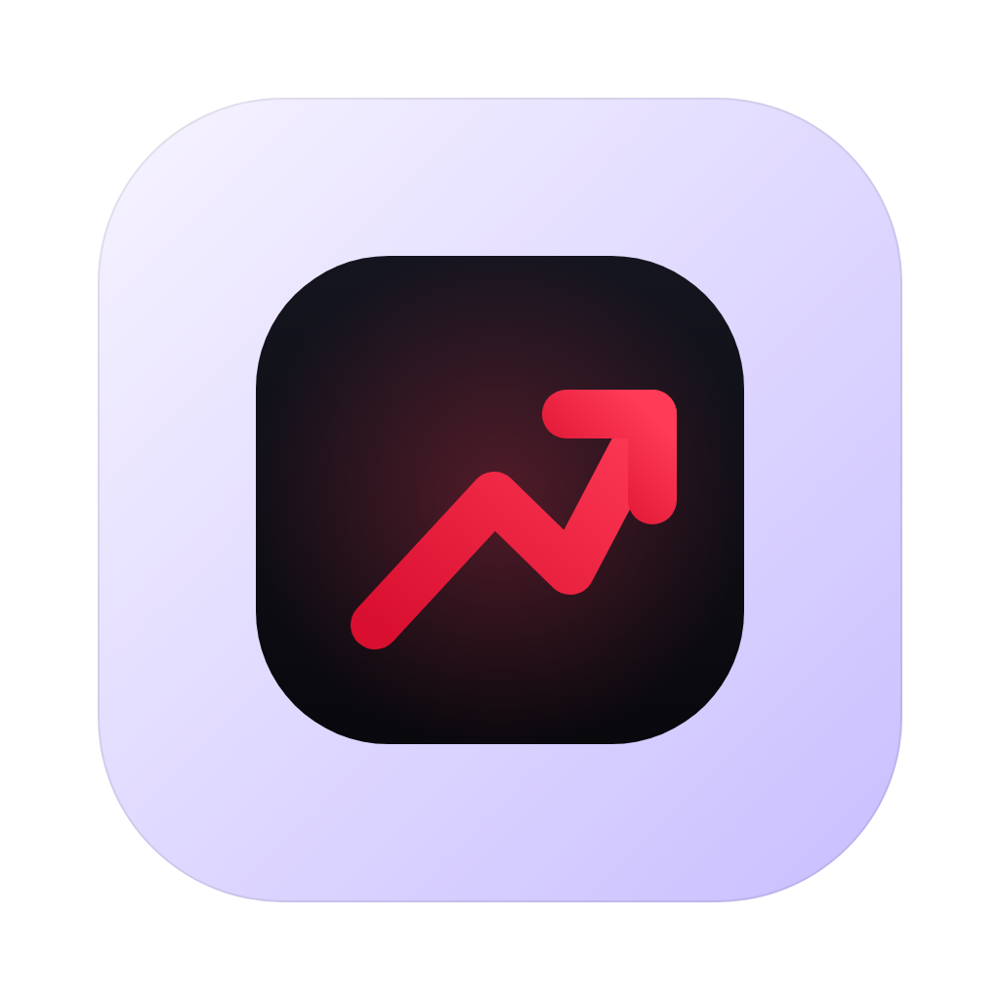
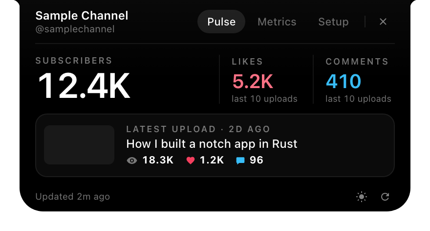
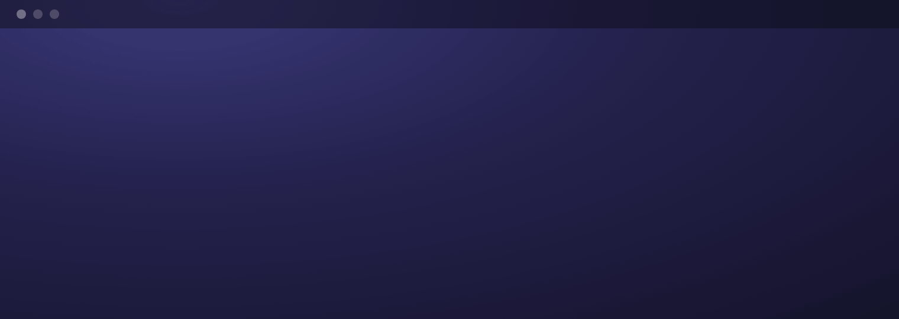
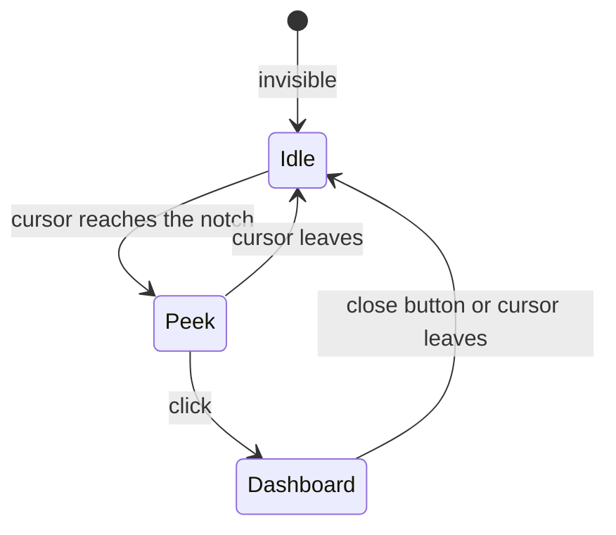
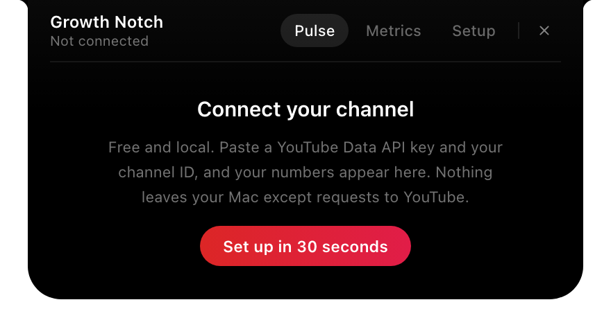
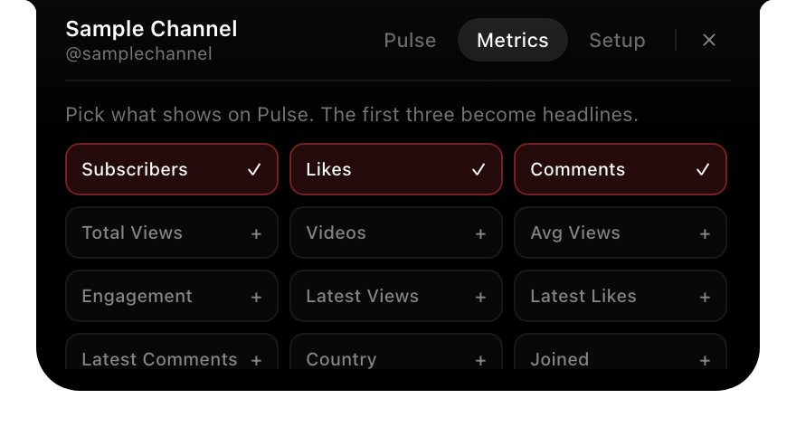
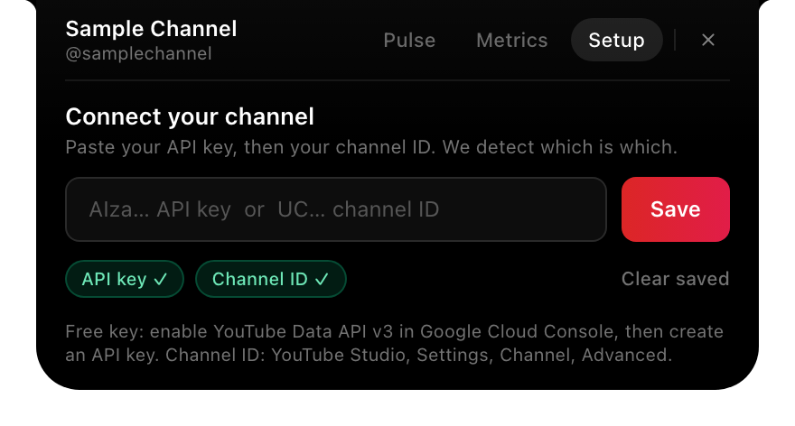
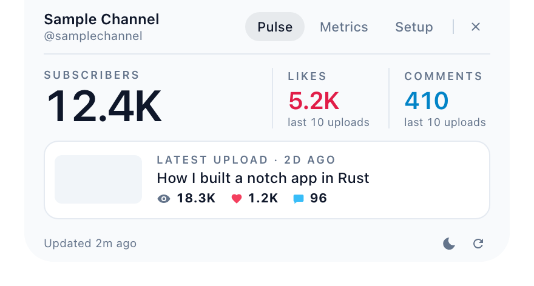
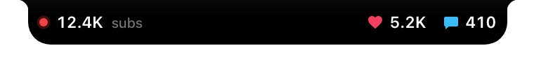
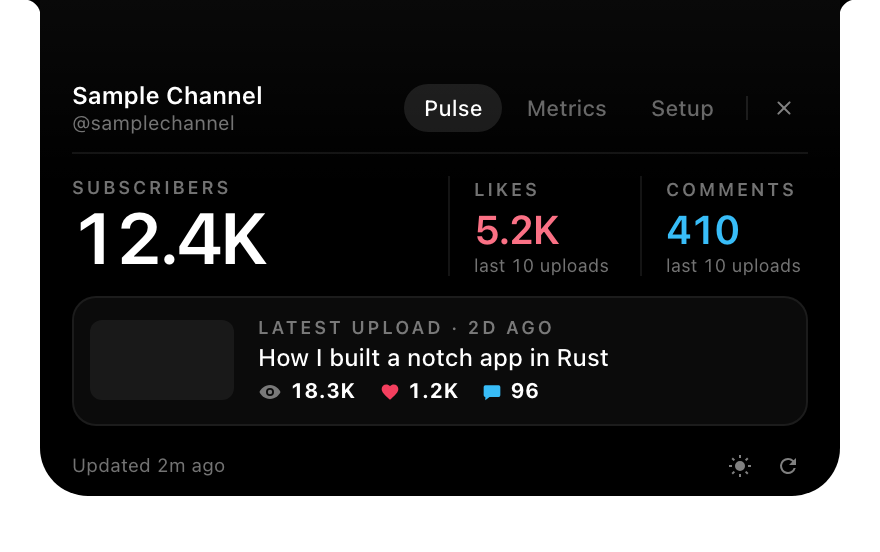

<p align="center">
  
</p>

<h1 align="center">Growth Notch</h1>

<p align="center">
  Your YouTube numbers, tucked into your MacBook's notch.<br>
  Free, local, and no account.
</p>

<p align="center">
  <a href="https://github.com/zribibecher/growth-notch/actions/workflows/ci.yml"></a>
  <a href="https://github.com/zribibecher/growth-notch/releases"></a>
  <a href="LICENSE"></a>
  
  
</p>

<p align="center">
  
  &nbsp;
  
</p>
<p align="center"><sub>Screenshots use sample data.</sub></p>

<!--
  A short screen recording belongs right here. Record idle, hover, click, tabs (8 to 10 seconds,
  under 3 MB), save it as docs/assets/demo.gif, then add:
  <p align="center"></p>
-->

Growth Notch stays hidden at the top of your screen. Move the cursor to the notch and your channel unfolds: subscribers, likes and comments. Click and you get a small dashboard with your latest upload. Move away and it disappears again.



The Setup tab is the one exception to the last arrow. It stays open while you paste your key, so a stray mouse move can't close it.

## Install

The app is not code signed yet, so macOS will say it can't verify the developer. After you move Growth Notch to `/Applications`, run this once:

```bash
xattr -dr com.apple.quarantine /Applications/GrowthNotch.app
```

1. Download the `.dmg` for your Mac from [Releases](https://github.com/zribibecher/growth-notch/releases). Use `aarch64` for Apple Silicon and `x64` for Intel.
2. Drag Growth Notch to Applications and run the command above.
3. Open it. A small icon appears in the menu bar and the dashboard opens so you can set it up.

A Homebrew cask template is in [`packaging/homebrew`](packaging/homebrew). It will be published in a tap with the first release.

## Set up

You bring your own free YouTube Data API key, so nothing goes through anyone else's server. It takes about a minute.

<p align="center"></p>

1. In [Google Cloud Console](https://console.cloud.google.com/), create a project, enable **YouTube Data API v3**, and create an API key.
2. Find your channel ID (it starts with `UC`) in YouTube Studio under Settings > Channel > Advanced settings.
3. Open the Setup tab and paste each one. Growth Notch works out which is which and shows a checkmark.

## What you can do with it

The Pulse tab shows your subscriber count as the headline, likes and comments next to it, and your latest upload with its thumbnail and age. The Metrics tab lets you add more numbers (total views, video count, average views, engagement and others). The sun icon switches between dark and light.

<p align="center">
  
  &nbsp;
  
  &nbsp;
  
</p>

## On a Mac with a notch

On a notched MacBook the pill matches the camera housing. Subscribers sit on the left of it, likes and comments on the right, and the dashboard starts below the housing.

<p align="center">
  
  &nbsp;
  
</p>

I developed this layout on a Mac without a notch, using a simulation (`NOTCH_SIM=1`), so it has not run on real notch hardware yet. If you have one, a screenshot or an issue would help a lot.

## Privacy and security

- Channel data comes from `www.googleapis.com`, requested by the Rust side of the app. Your avatar and video thumbnails load from YouTube's image hosts (`yt3.ggpht.com`, `yt3.googleusercontent.com`, `i.ytimg.com`). Nothing else is contacted.
- Your API key travels in a request header, never in a URL, so it can't end up in a log line or a redirect.
- There is no analytics, no telemetry and no account.
- Your key and channel ID are stored in `~/Library/Application Support/com.techuntangled.growth-notch/`, encrypted with ChaCha20-Poly1305. The folder is private to your user (mode `0700`) and the encryption key is a file in it (mode `0600`). That protects against casual reading and accidental commits. It does not protect against malware running as you, and it is not the macOS Keychain. [`docs/ARCHITECTURE.md`](docs/ARCHITECTURE.md) explains the trade-off.
- The web view runs under a strict Content Security Policy and can call seven commands, no more. Redirects are not followed, and API keys are scrubbed from error messages.
- To report a vulnerability, see [`SECURITY.md`](SECURITY.md).

## Limits worth knowing

- YouTube rounds public subscriber counts to three significant figures above 1,000, so one new subscriber may not move the number. The badge next to the count shows the change since the app started.
- Likes and comments are totals across your last 10 uploads, not lifetime channel totals.
- The quota counter is an estimate kept by the app. The default YouTube Data API quota is 10,000 units a day, and a full refresh costs 3. A refresh where nothing changed costs 1 or less.
- Tested on macOS 15 on an Intel Mac without a notch. The Apple Silicon build and real notch hardware are untested.

## Build from source

You need Node 22.12 or newer, Rust 1.90 or newer, and the Xcode command line tools.

```bash
git clone https://github.com/zribibecher/growth-notch.git
cd growth-notch
npm install
npm run tauri dev
```

```bash
npm test                          # React tests
npm run format                    # Prettier, for the web code
cd src-tauri && cargo test        # Rust tests, uses a local mock server
NOTCH_SIM=1 npm run tauri dev     # preview the notch layout on any Mac
```

## How it is put together

| Path | What lives there |
|---|---|
| `src/App.tsx`, `src/hooks/`, `src/components/` | The pill, its three stages, the tabs and the setup flow |
| `src-tauri/src/telemetry.rs` | The YouTube client, ETag cache and quota estimate |
| `src-tauri/src/credentials.rs` | The encrypted vault |
| `src-tauri/src/window.rs`, `panel.rs`, `watcher.rs` | The window, the AppKit tweaks and the hover watcher |
| `src-tauri/src/screen.rs` and `notch.rs` | Notch detection and window geometry |
| `docs/` | Architecture and design notes |

## Roadmap

- [x] Hover, peek and dashboard with a spring unfold
- [x] One-field setup and a first-run welcome
- [x] Layout that adapts to a notch
- [ ] Global shortcut to toggle the dashboard
- [ ] Launch at login
- [ ] A small celebration at subscriber milestones
- [ ] A sparkline for the latest video's views
- [ ] Signed and notarized releases with in-app updates

## Contributing

Issues and pull requests are welcome. [`CONTRIBUTING.md`](CONTRIBUTING.md) covers setup, tests and what a good pull request looks like.

## Credits

Growth Notch borrows its idle, peek and expanded model from [codenotch](https://github.com/vinzdg/codenotch) and was inspired by [boring.notch](https://github.com/TheBoredTeam/boring.notch). It is built with [Tauri](https://tauri.app). The heart icon is from [Material Design Icons](https://github.com/google/material-design-icons) (Apache-2.0).

Growth Notch is not affiliated with or endorsed by YouTube or Google. YouTube is a trademark of Google LLC.

## License

[MIT](LICENSE), copyright 2026 Becher Zribi.
